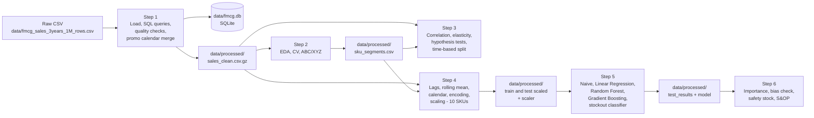

# FMCG Demand Planning and Forecasting

Capstone project for **Data Ladder (Data Scientist Track)**.
A time-series analysis of three years of daily FMCG sales (1.1M rows, 13 stores,
7 European countries, 102 SKUs): what drives demand, how well can we forecast it,
and what does a better forecast mean for inventory and fairness between sales channels.

**Status:** Complete. Steps 1 to 6 are finished and have been executed end to end.
**AI-assistance disclosure:** see [Tools and AI-assistance disclosure](#9-tools-and-ai-assistance-disclosure).

---

## Contents
1. [Executive summary and business problem](#1-executive-summary-and-business-problem)
2. [Data architecture and pipeline](#2-data-architecture-and-pipeline)
3. [Repository structure](#3-repository-structure)
4. [Environment setup](#4-environment-setup)
5. [How to run (Restart and Run All)](#5-how-to-run-restart-and-run-all)
6. [Results summary](#6-results-summary)
7. [Limitations](#7-limitations)
8. [Ethics note: Traditional Trade and dukas](#8-ethics-note-traditional-trade-and-dukas)
9. [Tools and AI-assistance disclosure](#9-tools-and-ai-assistance-disclosure)

---

## 1. Executive summary and business problem

**Business problem.** Forecast errors cost money. Over-forecasting ties up cash in
stock and carrying costs. Under-forecasting causes stockouts and lost sales. A planner
needs a forecast that is accurate enough to set safety stock, and needs to know
that it does not systematically short-change any sales channel.

**What was done.**

| Step | Question answered |
|---|---|
| 1. Data preparation and SQL | Is the data complete, correctly keyed and trustworthy? |
| 2. Exploratory analysis | What does demand look like (volatility, geography, ABC/XYZ segments)? |
| 3. Statistical testing | Do promotions and price drive demand? How do we split train/test fairly? |
| 4. Feature engineering | What can we know *before* a day starts (lags, rolling mean, calendar, promotions)? |
| 5. Forecasting | Which model forecasts store-SKU-day sales best? Can stockouts be predicted? |
| 6. Explainability and ethics | What drives the forecast? Is any channel treated unfairly? What does it save in safety stock? |

**Headline findings.**
- Promotions lift units by **+88.7%** (104.3 vs 55.3 units per row). The lift appears in all 403 of 403 promoted store-SKU series (paired check).
- **Gradient Boosting** forecasts store-SKU-day sales with **MAE 16.82**, which is **36.9% better** than the naive same-weekday-last-week forecast (26.65). Random Forest is effectively tied (16.87).
- Recent sales dominate the forecast: the **Momentum** feature group carries **76.7%** of importance, and the 7-day rolling mean alone carries 74.7%.
- Accuracy is much better when stores are added up: MAPE **9.69%** at SKU-day level vs **52.57%** at store-SKU-day level.
- At a 95% service level, Gradient Boosting needs about **13% less safety stock than Linear Regression** and about **36% less than the naive forecast**.
- **No sign of bias against the small-format channel**: all channel and country biases fall within ±2%.
- **Stockouts cannot be predicted** from the available features (ROC AUC 0.499, chance level), so that classifier should not be used for allocation.

---

## 2. Data architecture and pipeline

**Source data.** One CSV, `fmcg_sales_3years_1M_rows.csv` (about 212 MB, not stored in this repo; see
[`data/README.md`](data/README.md)). One row is **one SKU, in one store, on one day**.
It covers 2021-01-01 to 2023-12-31 (1,095 days), 1,100,000 rows, 13 stores in 9 cities and 7 countries,
four channels (Hypermarket, Supermarket, Convenience, E-commerce) and 102 SKUs.
There are no missing values and no true duplicates.



**Key design decisions**
- **Unique key = store + SKU + date.** The brief's suggested key (SKU + date + channel + city) flags 67,890 "duplicates", but they are two different Berlin hypermarkets, not repeated rows. Nothing was dropped.
- **Zero-sale days are kept.** They are real days with no demand (3,092 rows).
- **Promotion calendar** is built from the data (the dataset has no separate calendar file) and merged back with a left join. Row count and promo-day count (88,257) are verified unchanged after the merge.
- **Time-based split, never shuffled.** Train: dates before 2023-07-01. Test: 2023-07-01 onward (last six months).
- **No leakage by construction.** Lags and the 7-day rolling mean are computed *within each store-SKU series* and the rolling window is shifted by one day first, so today's sales never appear in today's features. Same-day stock and stockout fields are excluded from the sales model. The scaler is fitted on the training set only.
- **Modelling scope:** 10 SKUs chosen across ABC/XYZ segments (SKU0092, SKU0100, SKU0099, SKU0035, SKU0024, SKU0080, SKU0084, SKU0056, SKU0040, SKU0019), giving 101 store-SKU series and 110,595 rows (107,565 after dropping the first 30 days of each series for `lag_30`).
- **Forecast horizon:** one day ahead.

---

## 3. Repository structure

```
data-ladder-capstone-project/
├── data/
│   ├── README.md                      Where to get the raw CSV (tracked)
│   ├── fmcg_sales_3years_1M_rows.csv  Raw data (NOT tracked, download it yourself)
│   ├── fmcg.db                        SQLite database, created by Step 1 (NOT tracked)
│   └── processed/                     Created by the notebooks (NOT tracked)
│       ├── sales_clean.csv.gz         Step 1: cleaned sales + promotion calendar (NOT tracked)
│       ├── sku_segments.csv           Step 2: ABC/XYZ class of each SKU (NOT tracked)
│       ├── train_scaled.csv.gz        Step 4: scaled training set (88,981 rows) (NOT tracked)
│       ├── test_scaled.csv.gz         Step 4: scaled test set (18,584 rows) (NOT tracked)
│       ├── scaler.joblib              Step 4: StandardScaler fitted on train only (NOT tracked)
│       ├── test_results.csv           Step 5: actuals + every model's forecast (NOT tracked)
│       └── rf_reg.joblib              Step 5: fitted Random Forest (used in Step 6) (NOT tracked)
└── notebooks/
    ├── README.md
    ├── capstone_code.ipynb
├── scripts/
│   ├── README.md
├── .gitignore                         Keeps data, databases and compressed outputs out of Git  
├── README.md                          Status, results, disclosure (this file)
├── requirements.txt                   Python dependencies

```

---

## 4. Environment setup

**Requirements:** Python 3.9 or newer, and about 8 GB of RAM (the raw table has 1.1M rows).
`sqlite3` ships with Python.

```bash
# 1. Clone
git clone https://github.com/<your-username>/data-ladder-capstone-project.git
cd capstone-fmcg-forecasting

# 2. Install dependencies
pip install -r requirements.txt

```

Anaconda users can instead run `conda create -n fmcg-capstone python=3.11` and then `pip install -r requirements.txt`.

**Get the data.** Download the dataset as described in [`data/README.md`](data/README.md) and place it at:

```
data/fmcg_sales_3years_1M_rows.csv
```

---

## 5. How to run (Restart and Run All)

The notebook will generate the other files with (NOT TRACKED) in `data/processed/`, so .

**In Jupyter (interactive)**
1. From the project root run `jupyter notebook` (or `jupyter lab`).
2. Open `notebooks/capstone_code.ipynb`.
3. Choose **Kernel → Restart & Run All**. Wait for it to finish with no errors.
   
```

**What each step reads, writes and generates**

| Steps | Reads | Writes |
|---|---|---|
| 01 Data preparation and SQL | raw CSV | `data/fmcg.db`, `data/processed/sales_clean.csv.gz` |
| 02 Exploratory analysis | `sales_clean.csv.gz` | `data/processed/sku_segments.csv` |
| 03 Statistical testing | `sales_clean.csv.gz`, `sku_segments.csv` | nothing (the split is applied in memory) |
| 04 Feature engineering | `sales_clean.csv.gz`, `sku_segments.csv` | `train_scaled.csv.gz`, `test_scaled.csv.gz`, `scaler.joblib` |
| 05 ML forecasting | train and test scaled files | `test_results.csv`, `rf_reg.joblib` |
| 06 Explainability and ethics | `test_results.csv`, `rf_reg.joblib`, scaled files | figures and tables only |

**Reproducibility.** All models use `random_state=42`. The split date (`2023-07-01`) is the same in Steps 3 and 4.
After "Restart & Run All" the numbers in [Results](#6-results-summary) should match.

---

## 6. Results summary

All figures come from the executed notebooks. Percentages marked *(derived)* are arithmetic on notebook numbers.

### 6.1 Data quality (Step 1)

| Check | Result |
|---|---|
| Rows / period | 1,100,000 rows, 2021-01-01 to 2023-12-31 (1,095 days) |
| Stores / cities / countries / SKUs | 13 / 9 / 7 / 102 |
| Missing values / true duplicates | 0 / 0 |
| Promotion rows | 88,257 (8.0%) |
| Stockout rows | 33,114 (3.0%) |
| Zero-sale rows | 3,092 |
| Mean / median units per row | 59.2 / 49.0 |

### 6.2 Exploratory analysis and segmentation (Step 2)

- Demand is **seasonal with no growth trend**: summer peak (June to August), December peak, dips in February and September; yearly totals are flat at about 21.7M units.
- Volatility (CV) is almost identical across countries (**0.412 to 0.424**). Categories differ more: Beverages is highest (0.455), Dairy lowest (0.384).
- Lead time and stockouts are essentially unrelated (correlation 0.053; stockout rate flat at about 3%).
- **ABC (revenue):** A = 49 SKUs, B = 29, C = 24. Revenue is spread widely: 49 of 102 SKUs are needed to reach 80%.
- **XYZ (variability):** relative split into thirds (34 SKUs each), because no SKU exceeds the textbook CV limit of 0.5 (max 0.419).
- A-class products are spread evenly across X, Y and Z (17 / 15 / 17): big revenue does not mean predictable demand.
- 6 SKUs are class A in one country and class C in another.

### 6.3 Statistical testing (Step 3)

| Finding | Result |
|---|---|
| Promotion lift | **+88.7%** (104.3 vs 55.3 units); Welch t-test and Mann-Whitney both p < 0.001 |
| Robustness (same store-SKU compared with itself) | 403 of 403 series sell more on promo days; mean lift 1.87x (range 1.70 to 2.03); paired t-test p ≈ 7e-129 |
| Discount depth (avg units) | 0%: 55.3, 10%: 94.3, 15%: 100.3, 20%: 106.7, 30%: 116.2 |
| Price elasticity, A-SKUs (20 of 49 can be measured) | **-2.53** using all days; **-0.86** using promotion days only |
| Prices | List prices never change; 61 of 102 SKUs are never promoted |
| Split | Train 915,264 rows (to 2023-06-30), test 184,736 rows (from 2023-07-01) |

The all-days elasticity includes everything that comes with a promotion (displays, advertising), so it is a *promotional* elasticity, not a pure price effect.

### 6.4 Feature engineering (Step 4)

- 110,595 rows for 10 SKUs in 101 store-SKU series (1,095 days each).
- 3,030 rows dropped (101 series × 30 days for `lag_30`), leaving 107,565 rows with 0 missing values.
- **Train 88,981 rows / test 18,584 rows**, saved shapes (88,981, 31) and (18,584, 31).
- 18 model inputs in five groups: Momentum (`lag_1`, `lag_7`, `lag_30`, `rolling_mean_7`), Promotion, Calendar, Product (`list_price`), Location and channel.
- ADF stationarity test: 8 of 10 SKUs stationary; the 2 failures (both BY SKUs) are fixed by first differencing (p < 0.0001).
- Scaler fitted on train only (test statistics are close to but not exactly 0 / 1, which confirms no leakage).

### 6.5 Forecasting (Step 5): test set, store-SKU-day, 18,584 rows

| Model | MAE | RMSE | MAPE % |
|---|---|---|---|
| Naive (same weekday last week) | 26.65 | 41.65 | 69.21 |
| Linear Regression | 19.39 | 29.71 | 58.70 |
| Random Forest | 16.87 | 26.49 | **52.50** |
| **Gradient Boosting (best by MAE)** | **16.82** | **26.39** | 52.57 |

- Gradient Boosting MAE is **36.9% lower than naive**, **13.3% lower than Linear Regression** and 0.3% lower than Random Forest *(derived)*. Gradient Boosting and Random Forest are effectively tied; the safe claim is that tree-based models clearly beat the baselines.
- Relative error is about **26 to 28% of average demand for every SKU**. The highest MAPEs are the two BY SKUs (61.86% and 57.84%).

| Aggregation level | MAE | RMSE | MAPE % |
|---|---|---|---|
| Store-SKU-day | 16.82 | 26.39 | 52.57 |
| SKU-day (all stores added up) | 57.10 | 83.01 | **9.69** |

(Compare MAPE only; MAE and RMSE are on different scales of aggregation.)

**Stockout classifier (Random Forest, `class_weight="balanced"`)**

| Model | Precision | Recall | F1 | Share flagged |
|---|---|---|---|---|
| RF classifier | 0.031 | 0.340 | 0.056 | 0.338 |
| Random flags | 0.032 | 0.351 | 0.058 | 0.338 |

ROC AUC = **0.499** (chance). Stockout rates barely move with promotion (3.18% vs 3.04%), holidays (3.15% vs 3.05%) or after a stockout day (2.69%). The classifier carries no signal and **should not be used for allocation**.

### 6.6 Explainability, fairness and business impact (Step 6)

**What drives the forecast (Random Forest, impurity importance by group)**

| Group | Share |
|---|---|
| Momentum | **76.7%** (`rolling_mean_7` alone: 74.7%) |
| Promotion | 8.7% |
| Product (list price) | 6.9% |
| Location and channel | 4.0% |
| Calendar | 3.7% |

Permutation importance agrees: shuffling `rolling_mean_7` raises MAE by **+25.3 units** (model MAE is about 17). `list_price` importance is most likely SKU identity, because prices never change within a SKU.

**Fairness check (Gradient Boosting, test set)**

| Channel | Avg demand | MAE % of demand | Bias % | Under-forecast share |
|---|---|---|---|---|
| Convenience | 31.72 | 26.4 | +1.45 | 0.483 |
| E-commerce | 66.94 | 27.1 | +0.66 | 0.507 |
| Hypermarket | 71.27 | 27.0 | -0.03 | 0.512 |
| Supermarket | 49.57 | 26.0 | -0.46 | 0.512 |

Across channels *and* countries, bias is between **-1.8% and +1.5%** and the under-forecast share between 48.3% and 52.9%. There is no sign of systematic under-allocation to the small-format channel in this dataset (but see limitations).

**Safety stock at 95% service level** (z = 1.645; formula z × RMSE × √lead time; total units over the test period, 101 series)

| Model | Total units | vs Linear Regression | vs naive *(derived)* |
|---|---|---|---|
| Naive | 14,761.6 | +36.9% | 0.0% |
| Linear Regression | 10,783.1 | 0.0% | -27.0% |
| Random Forest | 9,390.7 | -12.9% | -36.4% |
| **Gradient Boosting** | **9,375.2** | **-13.1%** | **-36.5%** |

That is about 1,408 units saved vs Linear Regression and about 5,386 vs naive *(derived)*. It is an estimate in units; converting it to money needs unit and holding costs, which were not used.

### 6.7 S&OP recommendations
1. **Anchor on a frequently refreshed recent-sales baseline** and apply the promotion calendar as an overlay for promoted SKUs. Promotion plans must be entered before each forecast run.
2. **Plan at SKU level across stores** (MAPE 9.7%) and treat store-level forecasts (MAPE 52.6%) as indicative.
3. **Use the lower safety-stock requirement of the tree-based models** (about 13% below Linear Regression at 95% service).
4. **Monitor bias and under-forecast share by channel and country, and MAE as a share of demand by SKU**, and repeat the checks at every retraining. Suggested alert levels (my proposal, not a notebook result): bias outside ±5%, under-forecast share outside 45% to 55%, MAE above about 33% of demand.
5. **Do not use the stockout classifier.** Predicting stockouts needs new data: inbound shipment and purchase-order records, supplier delivery performance, stockout-corrected (unconstrained) demand, and finer stock-on-hand records.

---

## 7. Limitations

- **The data looks very regular** (almost identical volatility across countries, lead times and stockout rates across stores), which suggests it may be simulated. Findings describe this dataset, not the real world.
- **The target is recorded sales, not true demand.** Stockout days (33,114 rows, only 2,534 with zero units) understate demand.
- **No Traditional Trade or Wholesale channel exists in the data.** Convenience is only a stand-in for small-format retail, and it is the same data as the Netherlands (one store, about 6 series, 1,104 test rows), so the fairness result rests on little data.
- **Hyperparameters are fixed and untuned, and the best model was chosen on the test set** (no separate validation set), so the reported accuracy is slightly optimistic. Gradient Boosting and Random Forest are effectively tied.
- **One-day-ahead forecast** that uses actual `lag_1` values from the test period. A multi-week horizon needs recursive forecasting and would be less accurate.
- **p-values are optimistic** because daily observations of one series are not independent; the effect size and the paired check are more convincing than the p-values.
- **Promotions were not randomised**, so the lift is strong evidence but not proof of causation. Elasticity covers only 20 of 49 A-SKUs and is promotional, not purely price-driven.
- **XYZ classes are relative** (thirds), not the textbook CV limits.
- **ADF is run on all-store daily totals** per SKU, while the models forecast store-SKU-day.
- **Feature importance explains the Random Forest**, not the (marginally better) Gradient Boosting. The momentum features are correlated, so individual importances are understated.
- **The safety stock total** assumes independent, roughly normal daily errors and average lead time. The RMSE/MAE ratio of about 1.57 *(derived)* suggests heavier tails, so treat it as a planning estimate.
- The two Berlin hypermarkets look identical to the model because `store_id` is not a feature.

---

## 8. Ethics note: Traditional Trade and dukas

In many African markets, including Kenya, a large share of FMCG is sold through **Traditional Trade**:
dukas, kiosks and market stalls, rather than supermarkets and hypermarkets. A forecasting system must not
systematically under-allocate stock to these small outlets in favour of large modern ones.
For a household that buys staples from a duka, a stockout is not just lost revenue, it is a missing basic good.

- **Fairness monitoring.** Bias % and under-forecast share are reported by channel and country. In this dataset all are within ±2%, and Convenience is slightly *over*-forecast (+1.45%).
- **Demand vs sales (feedback loop).** Models learn from recorded sales. A channel that runs out of stock often looks like it has lower demand, receives less stock, and runs out more. Small outlets that are often out of stock are the most exposed.
- **Proxy warning.** This dataset has no Traditional Trade channel. The Convenience channel is only an approximate stand-in, based on one store. The result **must not be read as evidence that the model is fair to dukas**.
- **Before any real deployment:** collect sales and stock data from small outlets, check bias on that channel first, correct for stockout-censored demand, and keep a human review step on allocation decisions.
- **Transparency.** Feature importance is reported so planners can see what drives the forecast and can challenge it.

---

## 9. Tools and AI-assistance disclosure

**Tools:** Python, Jupyter, SQLite, pandas, NumPy, SciPy, statsmodels, scikit-learn, matplotlib, seaborn, joblib, Git/GitHub.

**AI assistance:** I used an AI assistant (Claude, by Anthropic) as a support tool during this project, for explaining
concepts, reviewing and debugging code, assistance in drafting documentation (this README and a study guide), and restructuring the repository.
The analysis was run by me in Jupyter, and every number in this README comes from the executed notebooks.
I reviewed the code and results and I am responsible for the content of this repository.

*Dataset:* see [`data/README.md`](data/README.md) for the source.
